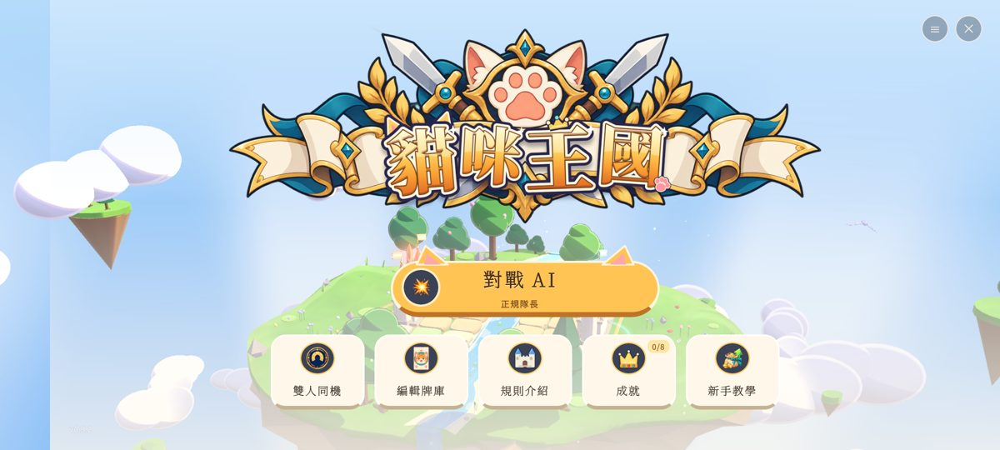
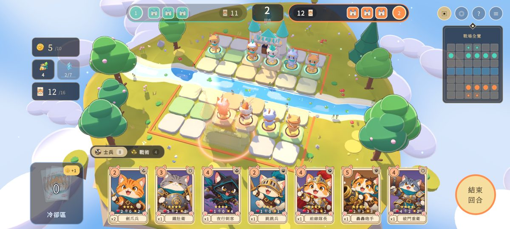
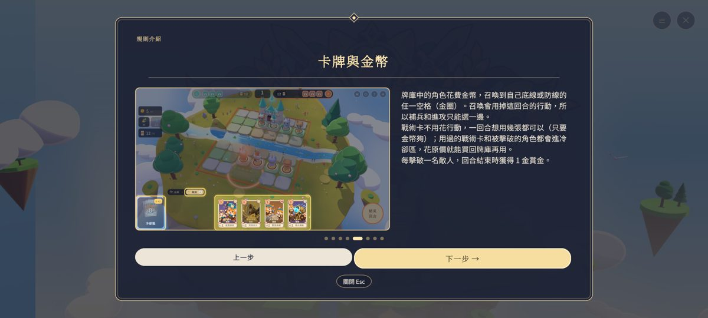

<h1 align="center">貓咪王國</h1>

3D 棋盤加卡牌的貓咪戰術對戰遊戲，可以單人挑戰五種難度的電腦，也能兩人用同一支手機輪流對戰。

<a href="https://github.com/y8999y-ops/cat-kingdom-download/releases/latest/download/CatKingdom.apk"><b>⬇ 下載 Android 版（最新版）</b></a>

---

## 安裝方式

1. 用手機打開上面的「下載 Android 版」連結。
2. 下載完成後，點開 `CatKingdom.apk`。
3. 手機會提示「允許安裝未知應用程式」，請允許。
   遊戲不是從 Google Play 下載的，所以會出現這個提示，這是正常的。
4. 有些手機（例如 OPPO、小米）會跳出安全掃描畫面，按「繼續安裝」即可。
5. 裝好後，桌面會出現「貓咪王國」的圖示。

**更新**：之後出新版，回到這個頁面下載最新版直接安裝，就會覆蓋舊版，遊戲紀錄會保留。

## 手機需求

- Android 8.0 以上，64 位元手機（近幾年的手機都是）。
- 建議 RAM 4 GB 以上；安裝檔大約 66 MB。

## 怎麼玩

- **目標**：雙方各有一座 3 點體力的城堡，先把對方城堡打到 0 的一方獲勝。
- **每回合**做一件事：移動一隻棋子（移動後自動攻擊範圍內所有敵人），或從牌庫召喚一名角色。
- **戰術卡**不佔行動，金幣夠就能連用。
- **晉階**：棋子打進敵陣可以晉階，變得更強。
- 標題畫面有「規則介紹」（附遊戲截圖）和手把手的「新手教學」，第一次玩建議先看。

## 手機操作

| 動作 | 功能 |
|---|---|
| 點一下 | 選取、移動、出牌 |
| 長按棋子或卡牌 | 查看詳細資訊 |
| 雙指捏合 | 縮放畫面 |
| 雙指拖曳 | 轉動視角 |
| 返回鍵 | 打開設定並暫停 |

畫質預設是「流暢」（中階手機約 60 fps），手機效能好的話，可以在設定裡改成「標準」或「精緻」。

## 遊戲畫面

---

目前是測試版，歡迎回報問題和建議。這個頁面只提供下載，遊戲原始碼不公開。
